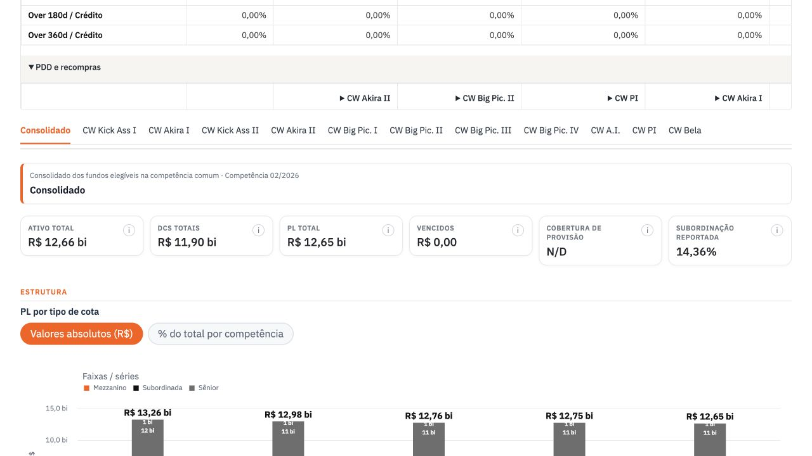
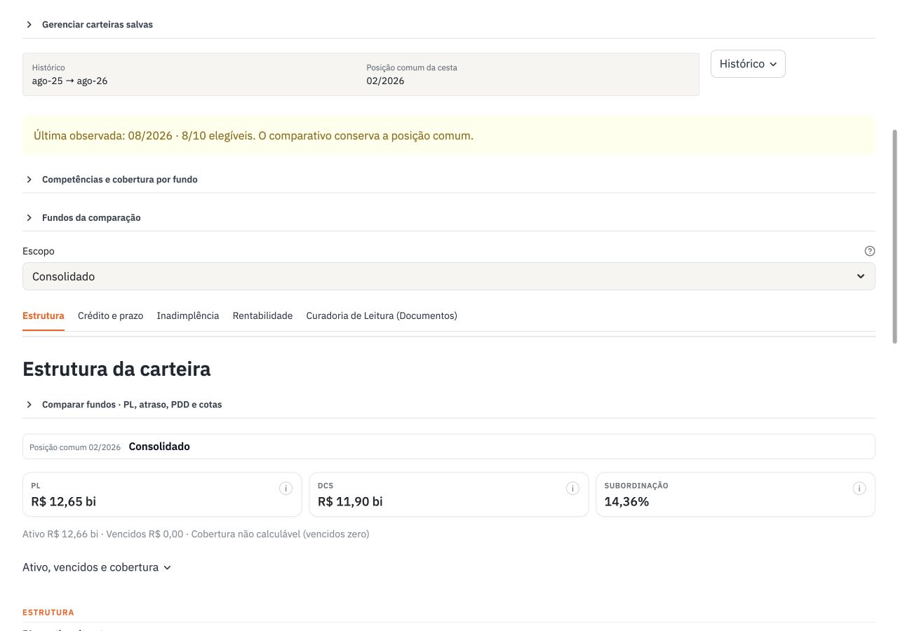
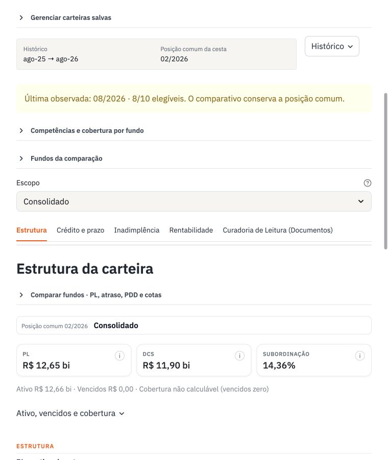
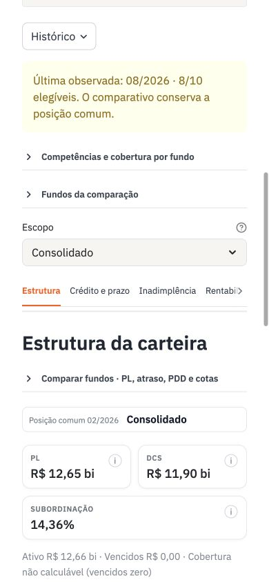

# Carteira: resultado local para revisão

**Status em 12/10/2026: implementação congelada em `ca008e8a`, com bloqueios de abertura no Office.** O PPTX realmente baixado pede reparo no PowerPoint; o Excel analítico final pede recuperação no Excel. Nenhum reparo foi aceito. O PR permanece em rascunho, sem merge ou publicação. A regra 9 do pedido determina parar e documentar nessa condição.

## Mudanças visíveis

- Cinco temas preservados, com um seletor de escopo no lugar das abas repetidas de fundos. Escolhas por carteira persistem entre reruns; só a aba ativa renderiza seus componentes.
- PL, direitos creditórios e subordinação recebem destaque. Ativo, vencidos e cobertura ficam em uma linha de apoio e na ajuda. Zero observado e cobertura com denominador zero têm explicação própria.
- Nomes curtos nos controles e títulos. Razão social, CNPJ, fonte, fórmula e ressalvas ficam na ajuda e nos arquivos de detalhe.
- Posição comum, última competência e histórico efetivo têm papéis distintos. A regra de competência comum e o lookback de cálculo foram preservados.
- PL mantém valores absolutos e visão percentual; legenda e composição seguem as séries originais. Exportações ficam após a análise, com peso secundário e produção sob demanda. O PPT conserva Preparar/Baixar para manter os avisos visíveis.
- PPT com uma capa, paginação contínua, rodapés curtos e referências nas notas. Componentes sem observações finitas e séries exatamente zeradas recebem registros explícitos; qualquer valor não zero, inclusive pequeno ou negativo, conserva a informação gráfica.
- Curadoria agrupa apenas colunas literalmente iguais. Todos os critérios, fundos e 15 ressalvas Cloudwalk permanecem. O Excel da carteira recorta RDB pelos CNPJs selecionados, com ausência documental explícita.

## Matriz antes/depois

Mesmos CNPJs, dados congelados e filtros em cada par. A = visão executiva; B = mensal; C = estrutura e emissões; D = leitura documental. O final retira a capa repetida B e acrescenta referências, sem alteração líquida da soma dos blocos.

| Carteira | Fundos | Antes A/B/C/D | Depois A/B/C/D | Total antes → depois | Verificação |
|---|---:|---|---|---|---|
| Cloudwalk (Fundos Adquirência 1T26) | 11 | 2 / 73 / 12 / 35 | 2 / 46 / 11 / 21 | 122 → 80 | Cinco downloads reais; PPT e Excel analítico bloqueados no Office |
| MELI (FIDCs Mercado Crédito 0, I e II) | 3 | 4 / 25 / 5 / 7 | 4 / 18 / 4 / 7 | 41 → 33 | Geração local e PDF; downloads finais e Office pendentes |
| Agis (Atlas) | 1 | 4 / 13 / 2 / 7 | 4 / 10 / 1 / 7 | 26 → 22 | Geração local e PDF; downloads finais e Office pendentes |

Supersim não tem IME disponível no cache local; foi conferido como ausência, sem inventar valores. Carteira 1 foi testada na navegação com seus 101 CNPJs e 102 escopos, incluindo Consolidado; não foi gerado o deck financeiro de 101 fundos.

Os [títulos completos, cortes e motivos por carteira](evidencias/carteira_export_e_pagina/matriz.json) acompanham a matriz. Reduções: divisores redundantes incorporados aos títulos; tabelas de retorno reunidas quando cabem com fonte legível; gráficos vazios substituídos por ausência explicada; zero observado registrado em componentes compactos; RDB sem registro resumido explicitamente; colunas documentais idênticas agrupadas. Cada fundo continua identificado, inclusive o fundo zerado. Os arquivos retêm números de crédito relevantes.

## Valores conferidos

Os **2.368 arquivos de entrada financeira/documental** não mudaram. O manifesto da matriz financeira antes/depois tem o mesmo SHA-256: `b0a23f02290d5bde912edc349d0121eeac42a1eac0f96f812bbb6ea054f46457`. Os valores originais não zero dos gráficos e as células nativas foram comparados com os produtores congelados.

| Referência | Valor preservado | Leitura |
|---|---:|---|
| Cloudwalk, posição comum fev/26 | PL R$ 12.654.615.584,18; DCs R$ 11.901.694.407,82; subordinação 14,36% | A posição comum continua puxada pelos fundos defasados |
| Cloudwalk, ago/26 | PDD R$ 7.341,46 | Valor pequeno continua presente; não foi tratado como zero |
| MELI Crédito, ago/26 | Over 90d R$ 585.560.777,63; PDD R$ 2.307.254.677,63 | Informação de crédito real preservada |
| Agis (Atlas), jun/26 | Over 90d R$ 37.906.949,58; PDD R$ 104.344.929,71 | Caso de um fundo preservado |

No download analítico Cloudwalk, a aba RDB passou de registros alheios à cesta para os 11 CNPJs selecionados, com “Não localizado” onde não há evidência cadastrada. As abas financeiras originais não foram recalculadas. Os [achados financeiros](achados_financeiros_carteira_apresentacao.md) ficam separados das decisões de apresentação.

## Validação e limites

- **255 testes aprovados**: todos os testes `test_portfolio*.py`, os quatro arquivos obrigatórios, downloads sob demanda e novas regras. Última execução, após congelar a implementação: 255 passed em 39,07 s.
- Quinze PDFs renderizados com LibreOffice: quatro blocos e apresentação final, para cada uma das três carteiras. Python-pptx preserva gráficos, tabelas e planilhas incorporadas; o final Cloudwalk tem 60 gráficos e 80 tabelas nativas.
- Cloudwalk conferida no navegador real nas cinco abas, em 1280, 760 e 390 px. Em 390 px, a página ocupa 390 px; a rolagem das tabelas fica contida. Ajuda abre por clique e Enter. A largura de celular foi simulada no desktop; dispositivo físico e gesto de toque não foram testados.
- Downloads efetivos Cloudwalk: resumo XLSX, base XLSX, CSV ZIP, estrutura XLSX e PPTX. Nenhum arquivo pesado foi produzido apenas por renderizar seu botão.
- Nos downloads Cloudwalk, os valores financeiros XLSX/CSV conferem os congelados sem delta de arredondamento. O PPT manteve os 60 gráficos nativos. Em oito tabelas de retorno, o app obteve CDI disponível onde a execução offline de referência tinha N/D; os retornos das cotas permanecem iguais. Essa diferença de disponibilidade do benchmark fica registrada separadamente do design e da costura.
- A abertura nativa encontrou bloqueios adicionais. Os quatro blocos PPT abrem isolados; sua concatenação já pede reparo, antes da padronização. O Excel analítico final também pediu recuperação. [Diagnóstico e proposta de correção](diagnostico_compatibilidade_office_carteira.md).
- O resumo Excel anterior à última inclusão de contexto abriu sem reparo. Isso não valida os demais arquivos finais. Downloads finais MELI/Agis e sua abertura no Office permanecem pendentes após a parada.
- Caches e cálculos não foram modificados. O servidor de validação pode materializar caches existentes ao executar os produtores; a comparação financeira usou entradas congeladas para evitar diferenças de serialização de ponto flutuante.
- A suíte inteira do repositório não foi declarada verde. Há falhas pré-existentes fora dos quatro arquivos obrigatórios, inclusive expectativa jun/26 versus dados ago/26 no teste analítico e expectativa antiga de texto na rota Deep Dive. O primeiro commit documental registrou 47 aprovações e uma falha herdada, corrigida no commit seguinte para o fluxo intencional sob demanda.

## Capturas

Antes e depois mostram a área de Estrutura no consolidado Cloudwalk. O cabeçalho e a navegação global do app foram preservados.

[Ajuda no celular](evidencias/carteira_export_e_pagina/cloudwalk_ajuda_mobile.png) · [Curadoria](evidencias/carteira_export_e_pagina/cloudwalk_curadoria.png)

## Reversão e dependências

Cada etapa tem um commit específico; a tabela abaixo identifica o ponto de reversão. Há dependências entre módulos novos e seus consumidores. **Reverter um módulo-base isoladamente enquanto os consumidores continuam ativos pode quebrar imports ou testes.** Esses itens exigem primeiro reverter seus consumidores, ou manter o helper e desativar o opt-in no consumidor. Essa limitação do histórico está registrada; não foi testada uma reversão independente de todos os commits.

| Item | Commits | Reversão proposta |
|---|---|---|
| Expansão anterior de Estrutura a todas as cestas | `09730513` | Reverter separadamente após retirar consumidores novos; essa etapa anterior ainda não estava em main |
| Proposta e teste do download herdado | `77131dc3`, `7ac7d964` | Reverter documentos/teste somente junto do comportamento correspondente |
| Moeda duplicada e eixo PL não negativo | `be9e92b6`, `e54f6a8e` | Reverter o commit objetivo escolhido; defaults compartilhados tiveram apenas esses reparos |
| Contexto e download callable | `7d04968a`, `a00e7e95` | Manter helpers enquanto usados; retirar chamadas antes de revertê-los |
| Cópia documental RDB, caminhos e truncamentos | `8dfce6cd` | Reverter esse reparo de apresentação C e seus testes |
| KPIs, nomes e ajuda da página | `7543e8f4`, `d7ddd697`, `016a4f43`, `37ba33fc` | Reverter consumidores/apresentação em ordem inversa; valores originais permanecem nos produtores |
| Contexto, ações secundárias e referências de snapshot | `78bcdad6`, `70cb1e71` | Reverter o fluxo da página antes dos helpers que ele importa |
| Opção documental, compactação C e D | `d422ca79`, `89973893`, `ccacc80a` | Desativar opções da carteira ou reverter chamadas antes dos produtores |
| Compactação mensal B | `8d4bac32` | Reverter caller e produtor juntos no commit; conservar helper de estados enquanto usado pela página |
| Navegação lazy e estado por cesta | `c71c3602` | Reverter esse commit estrutural da página e testar reruns/seleções |
| Qualificação de zero/cobertura e janela efetiva | `b4de9d97`, `62b53809` | Reverter refinamentos locais de mensagens e classificadores com seus testes |
| Capa, referências e numeração | `8e20b3ec`, `31441f09` | Retirar chamada do finalizer e seus testes; o bloqueio da concatenação existe também antes dele |
| Perímetro RDB do Excel | `1801346a` | Desativar `portfolio_mode` no download analítico ou reverter o commit e sua chamada |
| Bloco executivo A legível | `42d06bce` | Desativar `portfolio_mode` no produtor A; nenhuma mudança de dados |
| Ressalvas documentais integrais | `30f9fbfb` | Reverter apresentação/notes e teste; registrar a perda de avisos que isso implica |
| Contexto nos arquivos de dados | `ca008e8a` | Retirar wrapper nos três consumidores antes de remover o módulo de metadados; preservar produção financeira |

Para desfazer o escopo inteiro, fechar o PR em rascunho sem merge preserva main. O checkout principal, seu WIP e o PPTX anexado permaneceram fora dos commits.

## Retomada proposta

Correção isolada de conformidade da concatenação, seguida de abertura dos três downloads no PowerPoint sem reparo. O problema do Excel requer diagnóstico próprio antes de qualquer correção. Somente após aprovação para retomar, concluir Office/downloads MELI e Agis, repetir os checks afetados e apresentar o resultado para revisão. Infraestrutura, AWS, novo template/master visual e cálculos permanecem fora do escopo.
